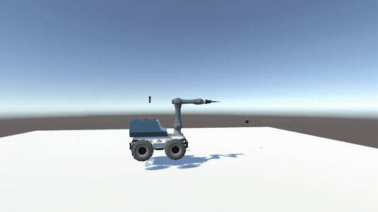

# Whole-body reinforcement learning for a mobile manipulator

A **Scout 2.0** mobile base carrying a **6-DOF Doosan A0509** arm learns to place its gripper frame
exactly on a target frame: same position **and** same orientation. The base and the arm are driven by
**one policy**. Simulation in **Unity ML-Agents**, learning with **Stable-Baselines3 PPO**.

Research internship (2nd year of engineering school, 2026) at the **CIAD** laboratory.
Author: **Farah Ben Slimene**.

<p align="center">
  
</p>

## What is in this repository

The task was built up in stages. Each stage below has its trained checkpoint, the code that produced
it, and evaluation videos in `deliverables/`.

| # | model | what it learns | observations / actions | result |
|---|---|---|---|---|
| 1 | base driver | drive the mobile base to a target point | 4 / 2 | 6/6 targets reached |
| 2 | 6-DOF arm | align the gripper frame with a target frame, arm only | 14 / 6 | ~96% within its ±20° training envelope |
| 3 | `s9_np` | whole body (base + arm), one fixed target | 14 / 8 | 5/5 aligned |
| 4 | `s9_tarc` | whole body, target sampled on a growing arc (curriculum) | 14 / 8 | 5/5 within 2 cm and 1.15° |

**Model 4 is the main result.** One end-to-end policy outputs joint velocity increments for the six arm
joints and the base linear and angular velocity. A target curriculum first moves the target farther
straight ahead (0.75 m → 2 m), then opens an arc of ±20°. The target is beyond the arm's reach, so the
base has to drive about 1.1 m before the arm does the final alignment.

- **Observations (14):** gripper pose (position + quaternion) and target pose, in the base frame.
- **Reward:** progress towards the target, orientation attraction, small directional terms and a
  jerk penalty, with +100 when the gate is reached and −50 on a fall.
- **Gate:** position error `d` < 2 cm and orientation error `φ` < 1.15°.
- **Evaluation:** three fixed targets 2 m away (on-axis, arc −20°, arc +20°), 5 passes,
  deterministic policy, 0.1 s per decision.

## Hybrid approach (credit)

The internship also compared the end-to-end policy with a **hybrid** approach. There, a **model-based
whole-body controller (PBVS + weighted damped least squares)** moves the robot, and a PPO policy only
chooses the weight of each joint.

**The PBVS + WDLS controller was developed by another intern at CIAD and is not included in this
repository.** My part was porting it to Unity and training the policy that outputs its weights.
Only the videos of the hybrid model (λ = 1) are included, in `deliverables/wb1am_model/lambda=1/`.

Both approaches reach every evaluation target. The end-to-end policy is faster and lands closer in
position. The hybrid controller follows a shorter, smoother path near the goal.

## Repository layout

```
Assets/scripts/                  base and arm agents (C#)
Assets/scoutsan_Baseline/        whole-body agent ScoutsanV1_1b.cs and the s9 scene
Assets/ScoutsanWholeBody/        TargetCurriculum.cs (the arc curriculum used by model 4)
Assets/scoutsan/                 robot description: URDF, meshes, prefabs, gripper
Assets/Scenes/                   base and arm scenes
Assets/python/                   Python side: Unity bridge, callbacks, training and evaluation scripts
scoutsan_Baseline/training/      training scripts for the whole-body runs
training/train.py                single launcher for the whole-body runs (presets + safety checks)
models/                          trained checkpoints, numbered as in the table above
deliverables/                    videos, evaluation data, figures and model cards per model
media/                           README preview
```

## Watching a trained model

1. Open the model's scene in Unity with **one** robot.
2. Set Behavior Parameters → Behavior Type = **Default**, then press **Play**.
3. Run the matching evaluation script. It connects to the Editor and writes its results into
   `deliverables/`.

```bash
cd Assets/python/scoutsan_trainer/scoutsan_trainer
R=$(cd ../../../.. && pwd)

# 1 - base driver (scene Assets/Scenes/base.unity)
ARM_WATCH_MODEL=$R/models/1_base_driver/ppo_bearing_angle_FLU_new_interrupted.zip \
ARM_OUT_DIR=$R/deliverables/base_model ARM_TIME_SCALE=1 python eval_base_flu.py

# 3 - whole body, fixed target (scene Assets/scoutsan_Baseline/scenes/s9.unity)
ARM_EVAL_MODEL=$R/models/3_s9_np/ppo_scoutsan_s9_np.zip \
ARM_OUT_DIR="$R/deliverables/s9_np_model/fixed target" ARM_TIME_SCALE=1 python eval_s9np.py

# 4 - whole body, arc curriculum (same scene, tArcLineArc ON)
ARM_EVAL_MODEL=$R/models/4_s9_tarc/ppo_scoutsan_s9_tarc.zip ARM_TIME_SCALE=1 python eval_s9tarc.py
```

The 6-DOF arm checkpoints are in `models/2_arm_6dof_candidates/` (see its `MANIFEST.md`). The final one
is `model_16arm_actionscale_v2/ppo_16arm_actionscale_v2_interrupted.zip`, used with
`Assets/scripts/Arm scripts/ArmAgentL.cs` in `Assets/Scenes/arm_6dof_demo.unity`.

## Training

```bash
python training/train.py --list              # available runs, scenes, ports and budgets
python training/train.py s9_tarc --dry-run   # run every check without launching
python training/train.py s9_tarc             # train
```

Training uses a headless Linux build of the scene, which is not shipped: rebuild it after any C#
change. `--dry-run` prints the scene, robot count and Inspector values to build with. The launcher
refuses to start if it would overwrite a finished model, if the build is missing or older than the
agent code, or if the port is already in use. Stop a run with `kill -INT <pid>` to save
`<prefix>_interrupted.zip`.

## Environment

| component | version |
|---|---|
| Unity | 2022.3 LTS + ML-Agents package |
| Python | 3.10 (mlagents-envs 0.30 does not support 3.11+) |
| mlagents-envs | 0.30.0 |
| stable-baselines3 | 2.3.2 |
| gymnasium / gym | 0.29.1 / 0.21.0 |
| torch | 2.x with CUDA |
| numpy | 1.21.2 (pinned by mlagents-envs) |

```bash
conda create -n unity-rl python=3.10 && conda activate unity-rl
pip install mlagents-envs==0.30.0 stable-baselines3==2.3.2 tensorboard
pip install torch --index-url https://download.pytorch.org/whl/cu126
pip install pandas matplotlib seaborn
```

Install `mlagents-envs` before `torch`, because it pins numpy and gym.

## Practical notes

- **The Inspector wins.** A serialized field takes its value from the scene, not from the C# default.
- **Any C# change invalidates the training build.** Rebuild before training.
- **Scenes are saved with one robot** for watching. Duplicate the robot (8 for the whole-body runs)
  before building for training.

## Third-party content

The robot description in `Assets/scoutsan/` is assembled from public packages under their own
licences: AgileX Scout description, Doosan Robotics `dsr_description`, DH-Robotics PGC-140 gripper,
Robotnik sensors, and Unity `ROS-TCP-Endpoint`.
